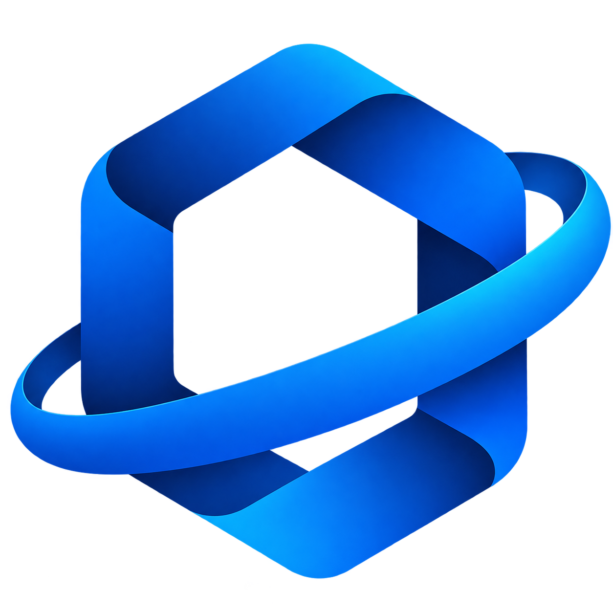

# 👋 Olá, eu sou Ariel da Luz Rosa

💻 **Desenvolvedor Full Stack em formação**  
📍 Santa Catarina, Brasil

---

## 🚀 Sobre mim

Sou desenvolvedor em formação, com experiência prática no desenvolvimento, manutenção e evolução de aplicações web, atuando tanto no **Front-end quanto no Back-end**.

Tenho experiência na construção de interfaces, desenvolvimento de APIs, integração com bancos de dados, autenticação, controle de permissões e implementação de funcionalidades para sistemas corporativos.

Durante minha trajetória, participei do desenvolvimento de soluções voltadas para necessidades reais, incluindo plataformas de gestão, controle de processos, atendimento e organização de informações.

🎯 **Principais áreas de interesse:**
- Desenvolvimento Full Stack
- Engenharia de Software
- Desenvolvimento de APIs
- Bancos de dados relacionais
- Autenticação e controle de acesso
- Integração entre sistemas
- Deploy e manutenção de aplicações

📚 Comprometido com o aprendizado contínuo e com a evolução profissional na área de tecnologia.

---

# 🏢 Projetos desenvolvidos para o SENAI

## 🏆 SIGA — Sistema Integrado de Gestão e Acessos

  

  <strong>Uma plataforma para centralização de processos, informações e operações em um único ambiente.</strong>

O **SIGA** é uma plataforma web desenvolvida para auxiliar na gestão de processos internos, reunindo diferentes módulos em um único ambiente.

O sistema integra funcionalidades de gestão de pessoas, empresas, visitantes, treinamentos, atendimento, documentação e controle de acesso, contribuindo para a organização das informações e dos processos operacionais.

### ⚙️ Principais funcionalidades

#### 📊 Gestão e monitoramento
- Dashboard com indicadores e informações dos módulos.
- Visualização consolidada de dados.
- Acompanhamento de informações operacionais.

#### 👥 Pessoas e empresas
- Gestão de pessoas e terceiros.
- Cadastro e gerenciamento de empresas autorizadas.
- Organização de informações cadastrais.
- Gestão de documentos relacionados às empresas.

#### 🚪 Controle de acesso
- Controle de portaria.
- Gestão e acompanhamento de visitantes.
- Identificação de unidades por localização, conforme a funcionalidade implementada.
- Controle de acesso aos módulos conforme as permissões dos usuários.

#### 💬 Comunicação e atendimento
- Chat integrado à plataforma.
- Central de chamados.
- Registro e acompanhamento de solicitações.
- Organização dos processos de atendimento.

#### 🎓 Treinamentos
- Gestão de treinamentos.
- Acompanhamento de situações e vencimentos.
- Organização das informações relacionadas aos treinamentos.

#### 🔐 Segurança e administração
- Gestão de usuários.
- Perfis e permissões de acesso.
- Controle de acesso por unidade.
- Auditoria de operações.
- Lixeira e recuperação de registros.
- Armazenamento de arquivos.

### 🛠️ Tecnologias utilizadas

  
  
  
  
  
  
  
  
  
  
  

### ☁️ Infraestrutura e publicação

| Plataforma | Utilização |
|---|---|
| Vercel | Publicação e hospedagem do Front-end |
| Render | Hospedagem do Back-end |
| Supabase | PostgreSQL e serviços de armazenamento, conforme a configuração do projeto |
| GitHub | Versionamento e gerenciamento do código |

---

## 📦 Sistema de Estoque

Sistema desenvolvido para auxiliar no controle e gerenciamento de estoque, centralizando informações sobre produtos e suas movimentações.

### ⚙️ Principais funcionalidades

- 📦 Cadastro e gerenciamento de produtos.
- 📊 Controle de estoque.
- 🔄 Registro de movimentações.
- 🔎 Pesquisa e consulta de produtos.
- 📋 Organização das informações.
- 👥 Controle de usuários e acessos.

### 🏆 Reconhecimento — Prêmio IEL

O projeto conquistou o **5º lugar no Prêmio IEL**, em uma competição de abrangência estadual que reuniu projetos desenvolvidos por estagiários de Santa Catarina.

Esse reconhecimento representa uma conquista importante na minha trajetória, destacando o desenvolvimento de uma solução tecnológica voltada para necessidades reais.

- 🥇 **Colocação:** 5º lugar.
- 🏅 **Abrangência:** Estadual — Santa Catarina.
- 💻 **Contexto:** Projeto desenvolvido durante o estágio.

### 🛠️ Tecnologias utilizadas

  
  

---

## 🎫 Sistema de Chamados

Sistema desenvolvido para organizar solicitações, centralizar atendimentos e acompanhar o andamento dos chamados.

### ⚙️ Principais funcionalidades

- 🎫 Abertura de chamados.
- 📝 Registro de solicitações.
- 🔄 Controle de status.
- 👤 Identificação do solicitante.
- 📋 Organização dos atendimentos.
- 🔎 Consulta de chamados.
- 📊 Acompanhamento das solicitações.

### 🛠️ Tecnologias utilizadas

  
  
  
  
  

---

# 💻 Tecnologias e ferramentas

### 🎨 Front-end

  
  
  
  
  
  
  

### ⚙️ Back-end e linguagens

  
  
  
  
  

### 🗄️ Banco de dados e infraestrutura

  
  
  
  
  

### 🔧 Ferramentas de desenvolvimento

  
  
  
  

---

# 📈 Minha trajetória

Acredito que a tecnologia vai além de escrever código: ela permite resolver problemas, melhorar processos e criar ferramentas que fazem a diferença no dia a dia das pessoas.

Meu objetivo é continuar evoluindo como desenvolvedor, aprofundar meus conhecimentos em Engenharia de Software e participar da criação de soluções cada vez mais completas, eficientes e confiáveis.

**Sempre aprendendo. Sempre desenvolvendo. Sempre evoluindo.** 🚀
